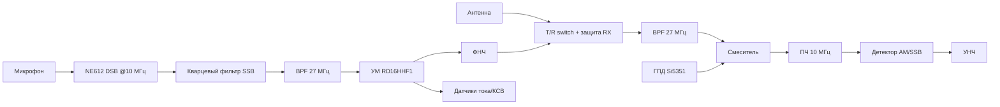

# Архитектура станции

## Этапы и подэтапы

### Этап 0 — Мастер-лист (`00_master`)
- Иерархия: `01_control`, `02_power_amp`, `03_rx_tx`.
- Все межблочные сигналы как иерархические пины.
- Только schematic, PCB не создаётся.

### Этап 1 — Плата управления (`01_control`)
- **1.1** — Входной узел защиты + DC-DC 12→5 В + LDO 3,3 В + `+3V3_SI`
- **1.2** — MCU: STM32F411 + кварц + SWD + UART
- **1.3** — Синтезатор: Si5351 + буферы VFO/BFO
- **1.4** — UI: OLED + энкодер + память каналов + RIT + squelch (программный)
- **1.5** — Интерфейсы и логика: PTT, входы I_sense/SWR_sense/PWR_LIMIT_SW/RX_audio, выход PWR_LIMIT_EN, разъёмы

### Этап 2 — Усилитель мощности (`02_power_amp`)
- **2.1** — Драйвер + 2× RD16HHF1 (push-pull)
- **2.2** — ФНЧ 27 МГц
- **2.3** — Датчики тока/КСВ + тумблер LIMIT/FULL + подстроечник + светодиод + вход PWR_LIMIT_EN + выход PWR_LIMIT_SW
- **2.4** — Тепловой расчёт + радиатор

### Этап 3 — Тракт RX/TX (`03_rx_tx`)
- **3.1** — BPF 27 МГц
- **3.2** — Смеситель + ПЧ 10 МГц + кварцевый фильтр
- **3.3** — Детектор AM/SSB + УНЧ + защита входа RX
- **3.4** — Формирователь SSB (фильтровый метод) + драйвер TX 2SC2078
- **3.5** — Питание: 12 В → LM7809 → локальные LDO

### Этап 4 — Корпусирование (`Mechanical`)
- **4.1** — Корпус
- **4.2** — Передняя панель
- **4.3** — Задняя панель
- **4.4** — Крепления в автомобиль
- **4.5** — Вентиляция

## Ключевые архитектурные решения
- **T/R switch**: реле на `02_power_amp`, антенный разъём там же. Защита RX — диоды + аттенюатор на `03_rx_tx`.
- **Ограничитель AM**: физический тумблер LIMIT/FULL на `02_power_amp`, обратная связь `PWR_LIMIT_SW` на `01_control`.
- **Squelch**: программный на `01_control`, сигнал `RX_audio` с `03_rx_tx` на ADC.
- **FM**: не делаем (решено 2026-10-31).
- **RIT**: программный на `01_control`, управление Si5351.

## Рекомендуемый порядок работ
1. Этап 0 (мастер-лист)
2. Контракты
3. 1.1–1.4
4. 2.1–2.2
5. **Совместно** 1.5 + 2.3
6. ⚠️ Изготовление платы этапа 1
7. 2.4
8. 3.1–3.5
9. 4.1–4.5