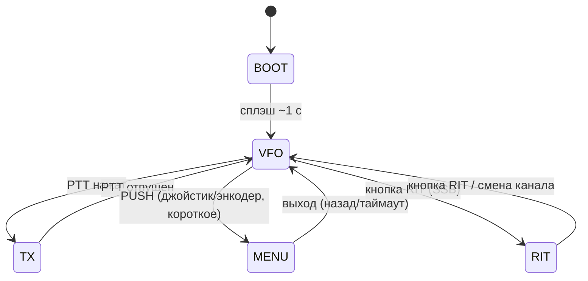

# Прошивка TRX 27 МГц — UI/UX (дизайн интерфейса)

> **Статус:** черновик дизайна (2026-11-03). Числовые пороги и шрифты —
> ориентировочные, уточняются на bring-up. Источник GPIO — `docs/bom/stage1_control.md`
> §1.4/§1.5, контракты — `docs/contracts/control_pa.md`, `docs/contracts/control_rxtx.md`.

---

## 1. Аппаратные органы и маппинг GPIO

| Элемент | Сигналы | GPIO | Тип |
|---------|---------|------|-----|
| Дисплей ST7789 2.0" 240×320 | MOSI, SCK, CS, DC, RST, BL | PA7, PA5, PA4, PA6, PA3, PB0 | SPI1 + GPIO + PWM |
| Энкодер HW-040 | ENC_CLK, ENC_DT, ENC_SW | PB12, PB13, PB14 | вход (active-low) |
| Джойстик 5-поз. | UP, DOWN, LEFT, RIGHT, PUSH | PC13, PC14, PC15, PB1, PB2 | вход (active-low) |
| Кнопка RIT | BTN_RIT | PB15 | вход (active-low) |
| PTT гарнитуры | PTT_IN | PB5 | вход (active-low) |
| PTT (выход на PA/RX-TX) | PTT | PA8 | выход 0/3,3 В |
| MUTE (squelch) | MUTE | PB8 | выход (1=заглушить) |
| MODE | MODE | PB9 | выход (0=SSB, 1=AM) |
| Ограничитель — чтение | PWR_LIMIT_SW | PA11 | вход (1=LIMIT, 0=FULL) |
| Ограничитель — управление | PWR_LIMIT_EN | PB10 | выход (1=включить) |
| Ток УМ | I_sense | PA0 | ADC |
| КСВ | SWR_sense | PA1 | ADC |
| RX_audio (squelch) | RX_audio_F | PA2 | ADC |
| Si5351 + EEPROM AT24C02C | I²C1 SCL/SDA | PB6/PB7 | I²C |

> Все кнопки/энкодер — замыкают линию на GND (active-low). На плате pull-up 10 кОм +
> RC 100 нФ (τ≈1 мс — дребезг гасится аппаратно), в прошивке — ещё программный
> антидребезг. Линии PTT_IN — pull-up 10 кОм + R32 1 кОм + C44 100 нФ.

> **Дисплей:** SPI1 (PA5=SCK, PA7=MOSI), CS/DC — программные GPIO (PA4/PA6), RST=PA3,
> подсветка BL=PB0 (PWM, active-low ключ Q1). Модуль ST7789 — без 5 В LDO, питание
> `+3V3_DISP` (LDO U9).

---

## 2. Экран (ST7789, 320×240, ландшафт)

Ориентация — ландшафт: 320 px (X) × 240 px (Z).

### 2.1 Основной экран (RX)

```
┌────────────────────────────────────────────────────────────┐
│ 27.135           CH 15        EU      ┐  частота/канал/сетка │
│ SSB  RIT +250 Hz   STEP 5k           │  режим/RIT/шаг        │
│────────────────────────────────────────────                 │
│  ████████████░░░░░░░░  S9+20         │  S-метр (RX)          │
│                                        │                       │
│  SQL 3    LIM ▸    +13.8V  1.2A      │  статус               │
│────────────────────────────────────────────                 │
│  ↑↓ кан.  ◄► режим  ● меню  ↻ частота│  подсказки            │
└────────────────────────────────────────────────────────────┘
```

Строки:
1. **Частота** (крупно, 3 знака после запятой = кГц) + **канал** (`CH 15`) + **сетка** (`EU`/`RUS`).
2. **Режим** (`SSB`/`AM`) + **RIT** (смещение, только в SSB) + **шаг** (`5k`/`10k`).
3. **S-метр** — полоса по уровню `RX_audio_F` (ADC); в TX — мощность/КСВ.
4. **Статус**: `SQL` (уровень squelch), `LIM` (активность ограничителя), напряжение/ток (при наличии I_sense).
5. **Подсказки** управления (динамические по состоянию).

### 2.2 Экран передачи (TX)

```
┌────────────────────────────────────────────────────────────┐
│ 27.135           CH 15              TX ▸                    │
│ AM    PWR 4.0W   SWR 1.3                                    │
│────────────────────────────────────────────                 │
│  ██████████░░░░░░░░░░  4.0 W        │  мощность (I_sense)   │
│  ██░░░░░░░░░░░░░░░░░░  SWR 1.3      │  КСВ (SWR_sense)      │
│────────────────────────────────────────────                 │
│  TX  MIC-LINE ок   LIM ▸                                    │
└────────────────────────────────────────────────────────────┘
```

### 2.3 Экран меню

```
┌────────────────────────────────────────────────────────────┐
│  МЕНЮ                                                        │
│  ▸ Сетка (Grid)           EU                                │
│    Шаг (Step)             5 кГц                              │
│    Режим (Mode)           AM                                │
│    Squelch                3                                  │
│    RIT шаг                100 Гц                             │
│    Яркость подсветки      80 %                               │
│    Сброс настроек         ...                                │
└────────────────────────────────────────────────────────────┘
```

### 2.4 Предупреждение (AM + тумблер FULL)

В **AM** при `PWR_LIMIT_SW == FULL` — поверх основного экрана мигающая плашка:

```
│  ⚠ AM: ограничитель FULL  4 Вт превышен!  │
```

Прошивка **не блокирует** передачу (только предупреждает) — по контракту
`control_pa.md` «тумблер в FULL + AM → предупреждение». Ограничение 4 Вт —
аппаратное (тумблер LIMIT) или программное (`PWR_LIMIT_EN=1`).

---

## 3. Конечный автомат



Приоритеты:
1. **PTT** — наивысший: из любого состояния переводит в TX (кроме BOOT).
2. **Предупреждение LIM** — оверлей поверх VFO/TX, не меняет состояние.
3. **Squelch** (MUTE) — фоновый процесс, не отдельное состояние.

---

## 4. Управление (маппинг входов)

### 4.1 Состояние VFO (основное)

| Вход | Действие | Примечание |
|------|----------|------------|
| Энкодер ↻ | Частота ± шаг | шаг STEP (5/10 кГц), в «точном» режиме 100 Гц |
| Энкодер (короткое) | Шаг 5k ↔ 10k | |
| Энкодер (длинное) | Меню | |
| Джойстик ↑/↓ | Канал +1/−1 | по выбранной сетке |
| Джойстик ◄/► | Режим SSB ↔ AM | пишет MODE (PB9) |
| Джойстик PUSH (короткое) | Меню | |
| RIT (короткое) | RIT вкл/выкл | только SSB |
| RIT (двойное) | RIT → 0 | быстрый сброс |
| PTT | TX | приоритет |

### 4.2 Состояние MENU

| Вход | Действие |
|------|----------|
| Энкодер ↻ | Навигация по пунктам |
| Энкодер (короткое) / PUSH | Выбрать пункт |
| Джойстик ◄/► | Изменить значение (внутри пункта) |
| Джойстик ↑/↓ | Навигация |
| Энкодер (длинное) / PUSH (длинное) | Назад / выход |
| Бездействие 10 с | Автовыход в VFO |

### 4.3 Состояние RIT

| Вход | Действие |
|------|----------|
| Энкодер ↻ | RIT ± шаг (10/100 Гц) |
| RIT (короткое) | Выход из RIT (сохранить) |
| RIT (двойное) | RIT → 0 и выход |
| Смена канала | Автосброс RIT (настраиваемо) |

> Все нажатия различаются по длительности: **короткое** (< 300 мс), **длинное**
> (≥ 700 мс), **двойное** (2 коротких за < 350 мс). Дребезг — аппаратный RC + ПО.

---

## 5. Меню (дерево)

```
МЕНЮ
├── Сетка (Grid)            EU / RUS            (сдвиг −5 кГц)
├── Шаг (Step)              5 кГц / 10 кГц
├── Режим (Mode)            SSB / AM            (дублирует ◄/►)
├── Squelch                 Уровень 0–9         (порог ADC, 0=выкл)
├── RIT шаг                 10 Гц / 100 Гц
├── RIT автосброс           вкл / выкл          (при смене канала)
├── Яркость подсветки       0–100 %             (PWM PB0)
├── Защита по КСВ           порог / действие    (MUTE + сброс TX)
├── Каналы                  Сохранить / Вызвать / Стереть
├── Сброс настроек          factory reset
└── Инфо                    версия, U, I, SWR, RIT
```

---

## 6. Каналы и сетки

- **EU:** 26,965 МГц + 10 кГц (40 каналов), «пятёрки» — промежуточные +5 кГц.
- **RUS:** сдвиг **−5 кГц** относительно EU.
- **Вызывная SSB:** 27,190 МГц.
- Шаг перестройки — **5 кГц** (покрывает EU/RUS/пятёрки).
- Отображение: частота «27.135», канал «CH 15», сетка «EU/RUS».

> Синтез: Si5351 CLK0 = VFO (~37 МГц, меняется с каналом), CLK1 = BFO (10 МГц).
> Точная формула «частота → VFO/BFO» — по `docs/design_decisions_stage3.md`
> (ВЧ-тракт этапа 3), фиксируется на bring-up.

---

## 7. RIT (расстройка SSB)

- Диапазон **±1 кГц**, шаг **10 Гц** (мелкий) / **100 Гц** (крупный).
- Включение/сброс — кнопка RIT; двойное нажатие — сброс в 0.
- Реализация — программная поправка VFO (Si5351 CLK0).
- Обновление Si5351 раз в **50–100 мс** (без щелчков).
- Хранение — EEPROM (AT24C02C), привязка к каналу (опция — глобально).
- Автосброс при смене канала — настраиваемо (меню).

---

## 8. Squelch (шумоподавитель)

- Вход — `RX_audio_F` (PA2, ADC), RC-фильтр τ=10 мкс (антиалиасинг).
- Алгоритм: скользящее среднее / RMS амплитуды; если ниже порога `SQL` — `MUTE=1`
  (закрыть УНЧ), выше — `MUTE=0`.
- Порог 0–9 — в меню; 0 = squelch выключен (всегда открыт).
- Гистерезис по уровню (чтобы не «дёргало» на шуме) — ±1 ступень.

---

## 9. Ограничитель мощности (AM)

- Чтение `PWR_LIMIT_SW` (PA11): 1 = LIMIT, 0 = FULL.
- Индикация: в AM и FULL — **предупреждение** на экране (см. §2.4). В LIMIT —
  значок `LIM`.
- `PWR_LIMIT_EN` (PB10): программное включение ограничителя (резерв — автосброс
  TX по высокому КСВ). По умолчанию **0** (следуем тумблеру).
- **SSB:** ограничитель не действует (лимит 12 Вт пиковой), предупреждений нет.
- Панельный LED LIM — аппаратно с `02_power_amp` (не от прошивки).

---

## 10. Светодиоды и индикация

| LED (панель) | Источник | Логика |
|--------------|----------|--------|
| PWR | `+5V` (аппаратно) | горит при питании |
| TX | `PTT` (PA8, аппаратно через R39) | горит при передаче |
| LIM | `02_power_amp` (`J_LIM_LED_1`) | горит при LIMIT (аппаратно) |

Прошивка **не управляет** панельными LED напрямую (кроме логики `PTT`/`PWR_LIMIT_EN`).
Платные дубли D4–D8 — для отладки без корпуса.

---

## 11. Память

- **Каналы и настройки** — внешняя EEPROM **AT24C02C** (I²C, PB6/PB7) — RIT/каналы.
- Альтернатива (запасная) — внутренняя Flash STM32F411 (эмуляция EEPROM).
  Приоритет — внешняя AT24C02C (добавлена в схему 1.5).
- Формат записи — TBD при реализации драйвера EEPROM.

---

## 12. Открытые вопросы (решения на bring-up)

| # | Вопрос | Примечание |
|---|--------|------------|
| 1 | Формула «частота ↔ VFO/BFO» | по `design_decisions_stage3.md` |
| 2 | Точные пороги squelch (ADC) | замерить по RX_audio |
| 3 | Шкала S-метра / мощности | калибровка по I_sense/SWR_sense |
| 4 | Формат EEPROM (AT24C02C) | при реализации драйвера |
| 5 | Шрифты/размеры экрана | выбрать при вёрстке (Arduino_GFX) |
| 6 | Драйвер дисплея | **Arduino_GFX** (`moononournation/GFX Library for Arduino`) — выбран и собирается на STM32; TFT_eSPI — запасной (быстрее, но нужен User_Setup.h) |

---

## Статус

**Дизайн зафиксирован (2026-11-03).** Маппинг GPIO — по фактической схеме
`01_control` (ERC=0). Реализация — в `Firmware/` (PlatformIO, `genericSTM32F411CE`, HSI).
