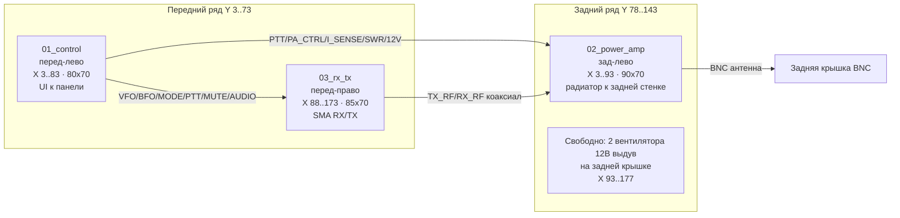

# Компоновка плат, разъёмов и кабелей (PCB placement plan)

> **Статус:** ЧЕРНОВИК v0.1 — на согласование.
> **Зачем:** единый подготовительный регламент перед `Update PCB from Schematic` и
> разводкой трёх плат. Фиксирует **что** размещаем, **где** в корпусе и **какими
> проводами** соединяем.
>
> **Источники правды (не дублировать):** пинаут сигналов — `inter-module-pinout.md`
> и `contracts/`; позиции панельных органов — `front_panel_elements.md` /
> `back_cover_elements.md`; числа — `Mechanical/params.py`. Этот документ сводит их
> в компоновку и добавляет то, чего нигде нет: габариты плат, их место в корпусе и
> кабельную таблицу.

---

## 0. Цели и принципы

1. **Один источник правды** — компоновка живёт здесь; при расхождении обновляется
   этот документ, затем платы/механика.
2. **Размещение по потоку сигнала** — антенна и УМ сзади, UI спереди, тракт RX/TX
   между ними.
3. **Терморазвязка** — УМ (RD16HHF1 + радиатор) у задней стенки, с продувом.
4. **Короткие линии** — ВЧ/чувствительный аналог короче, чем логика; земля рядом.
5. **Разделение жгутов** — силовые слева, сигнальные в центре/справа (решение).
6. **Обслуживаемость** — панельные органы на плату только через ответные разъёмы с
   ключом (XH2.54), ничего «намертво» там, где жгут должен сниматься.

---

## 1. Исходные данные

| Параметр | Значение | Источник |
|---|---|---|
| Полость (свет) X × Y × Z | **180 × ~144 × 50 мм** | `params.py` `CASE_W/CASE_D/CASE_H`, минус T_BACK 2.4 + передняя панель 13.4 |
| Внешний габарит корпуса | 186 × 56 мм | `params.py` / `Mechanical/README.md` |
| Толщина стенки скорлупы | 3.0 мм | `params.py` `SHELL_WALL` |
| Передняя панель (корытце) | 186 × 13.4 × 56 | `Mechanical/README.md` |
| Радиатор УМ | HS 104-30 (общий на 2×TO-220) | `docs/bom/stage2_power_amp.md` §2.4 |
| Платы | 3 шт (`01_control`, `02_power_amp`, `03_rx_tx`), 2 слоя | — |
| Предрегулятор | **LTC3780** (buck-boost, заводская плата), выход **13,8 В**, 7 А (ном.) / 10 А (макс.) | решение |
| Входная защита | предохранитель **5 А** (перенесён с `01_control` на корпус, до LTC3780) + TVS (load dump) + диод реверса | решение |
| Вентиляторы | 2 шт, **40×40 мм, 12 В**, на **задней крышке** (выдув) | решение |
| Разъёмы | control 18, power_amp 9, rx_tx 9 | факт `sch_get_symbols` |

---

## 2. Габариты плат (прикидка)

**Метод:** сумма площадей footprint'ов × коэффициент укладки **~2.5** (2 слоя, ручная
пайка, 0603) + запас на разъёмы по периметру и крепёж. Это **первый проход** — точные
размеры выйдут при `Update PCB from Schematic` и разводке.

> **Габариты ПРИНЯТО (2026-10-31).** Если в процессе PCB увеличатся — правим этот
> документ и раскладку §3.

| Плата | Реальных комп. | Целевой габарит (Ш×Г, мм) | Что лимитирует |
|---|---|---|---|
| `01_control` | ~122 | **80 × 70** (до 85×80) | 18 разъёмов по периметру, QFN-48 7×7, TO-263, 2 электролита |
| `02_power_amp` | ~61 | **90 × 70** + радиатор | 2×TO-220 + HS 104-30, 4 тороида, 3 SMA edge |
| `03_rx_tx` | ~117 | **85 × 70** | 4 кварца HC-49SD, реле IM06GR, 2×TO-220/TO-92, 2 SMA edge |
| **LTC3780** (предрегулятор, заводская плата) | — | по факту платы | buck-boost 5–32 В → 13,8 В, 7 А (ном.) / 10 А (макс.), M3/стойки |

> `01_control` укладывается в заявленный ранее потолок «≤ 9×9 см» (README платы).

**Бюджет высоты (Z):** полость 50 мм. Плата + самый высокий компонент + стойка
≤ **45 мм** (запас 5 мм). Самые высокие: TO-220 ≈ 11 мм, электролит 12.5 мм,
радиатор HS 104-30 (уложить в ≤ 45 мм, финны вдоль задней стенки).

---

## 3. Размещение плат в корпусе

Все три платы — **горизонтально на дне** (плоскость X–Y). Ориентир осей: X = ширина
(0…180, слева направо), Y = глубина (0 = передняя панель, ~144 = задняя крышка),
Z = высота (0…50).

| Плата | Позиция (X×Y, мм) | Ориентация | Сторона разъёмов |
|---|---|---|---|
| `01_control` | 3..83 × 3..73 (перед-лево) | горизонтально | UI — на передней кромке (к панели); межплатные — на правой/задней |
| `03_rx_tx` | 88..173 × 3..73 (перед-право) | горизонтально | SMA RX/TX — к центру/тылу; XH2.54 — к центру |
| `02_power_amp` | 3..93 × 78..143 (зад-лево) | горизонтально | SMA J_ANT_1 — к задней крышке; J_PA_* — к центру/левой стенке |

**Зоны (решения пользователя, зафиксировано 2026-10-31):**
- **Питание (12 В, автомобильное):** входит через DC-джек (зад), **тумблер PWR разрывает +12V**
  (GND — напрямую), затем **входная защита** (предохранитель 5 А + TVS load dump + диод
  реверса) → **LTC3780 (buck-boost, заводская плата) → стабильные 13,8 В** → `J_12V_IN_1`.
  **Все схемы остаются как есть** (LM2596S-5.0 и раздача `+12V_PA`/`+12V_RXTX` на
  `01_control` — без изменений; шины «12 В» = номинал, фактически 13,8 В). Силовые
  провода — **по левой стенке** (X≈0). Правая стенка и центр — только сигнальные/межплатные.
- **LTC3780 + входная защита** — в силовой зоне у левой стенки, M3/стойки, клеммники под
  винт (заводская плата). **Предохранитель перенесён с `01_control` сюда** (защищает весь
  прибор). Входная защита обязательна: вход LTC3780 ≤ 32 В, а load dump — до 40–60 В.
- **УМ у задней крышки**, радиатор там же; **жабры на задней стенке + 2 вентилятора 12 В
  на задней крышке (выдув)** (зона X 93..177 × Y 78..143, поток «задняя стенка → наружу»).
- **Панельные органы сильно меньше**, конфликта с платами нет (проверено). Резерв
  Y 0..3 под выступающие тела панельных элементов.

**Поток сигнала (сводно):**
- ТХ: MIC (перед) → `01_control` (`MIC_LINE`) → `03_rx_tx` (SSB+BPF) → `TX_RF` (коаксиал) → `02_power_amp` → BNC.
- RX: BNC → `02_power_amp` (T/R) → `RX_RF` (коаксиал) → `03_rx_tx` (защита/BPF/детектор/УНЧ) → динамик + `RX_audio` → `01_control` (squelch).

---

## 4. Пинаут разъёмов

Пинаут сигналов **не дублируем** — он в `inter-module-pinout.md` и `contracts/`.
Здесь фиксируем только **правила единой раскладки**:

1. **GND — на крайнем пине** каждой группы (пин 1 или последний), кроме силовых
   клеммников, где GND = пин 2.
2. **Силовые разъёмы отдельно** от сигнальных (входной `J_12V_IN_1` — клеммник 5.0 мм; раздача +12V на другие платы — через внешние WAGO 221-415).
3. **Чувствительные линии — витой парой с собственным GND** (VFO, BFO, I_sense,
   SWR_sense, RX_audio, MIC_LINE) — каждый сигнал со своим возвратным пином.
4. **Ориентация разъёма** на кромке платы должна соответствовать направлению жгута
   (передняя кромка → панель; задняя/боковая → соседняя плата) — см. §8.

---

## 5. Кабель-менеджмент (кабельная таблица)

Типы проводов:
- **ВЧ 50 Ом** — коаксиал RG-174/RG-316, минимальная длина.
- **Аналог чувствительный** — витая пара AWG28 (сигнал + GND).
- **Логика/однопроводные** — AWG28 одиночный.
- **Силовые** — AWG20 (12 В), можно AWG18 на вход; отдельный жгут.
- **Панельные LED/кнопки** — AWG28, короткие «летящие» проводники.

Правила трасс: ВЧ не вдоль аудио/силовых; аналог не вдоль DC-DC/коммутируемых;
силовые жгуты — только левая стенка.

### Жгут «Питание» (левая стенка)

Раздача +12V и GND — **внешними клеммами WAGO 221-415** (5-проводные, 32 А / 450 В). Два блока: один на +12V, один на GND.

| Откуда | Куда | Сигнал | Провод | Длина¹ | Трасса |
|---|---|---|---|---|---|
| DC-джек (зад) | тумблер PWR (перед) | +12V (разрыв) | AWG20 ×1 | ~170 | левая стенка, вперёд |
| тумблер PWR (перед) | входная защита (предохранитель+TVS+диод) | +12V | AWG18 ×1 | ~100 | левая стенка, назад |
| входная защита | LTC3780 (вх) | +12V | AWG18 ×1 | ~30 | левая стенка |
| LTC3780 (вых) | WAGO +12V | +12V (стабилиз. 13,8 В) | AWG18 ×1 | ~30 | левая стенка |
| WAGO +12V | `01_control` `J_12V_IN_1` | +12V | AWG18 ×1 | ~60 | левая стенка |
| WAGO +12V | `02_power_amp` (вх питания) | +12V_PA | AWG18 ×1 | ~90 | левая стенка, назад |
| WAGO +12V | `03_rx_tx` (вх питания) | +12V_RXTX | AWG18 ×1 | ~70 | центр |
| WAGO GND | `01_control` / `02_power_amp` / `03_rx_tx` | GND | AWG18 ×3 | ~60/90/70 | левая стенка |
| WAGO +12V | вентиляторы 12 В (зад. крышка) | +12V, GND | AWG20 ×2 | ~120 | левая стенка → зад |

> **LTC3780** — заводская buck-boost плата (предрегулятор 13,8 В, 7 А ном.). **Ничего не
> заменяет**: LM2596S-5.0 на `01_control` — как есть. **Входная защита
> (предохранитель 5 А + TVS load dump + диод реверса) обязательна перед LTC3780** — вход
> модуля ≤ 32 В, а load dump достигает 40–60 В. Токовый лимит модуля — 6–7 А.
> **Раздача +12V — через WAGO 221-415, снята с платы `01_control`** (убраны `J_PA_PWR_1`,
> `J_RXTX_PWR_1`, R29/R30). D1/D2 (TVS+диод) остались вторым рубежом на `01_control`.

### Жгут «Сигналы 1↔2» (левая стенка)

| Откуда | Куда | Сигнал | Провод | Длина¹ |
|---|---|---|---|---|
| `01_control` `J_PA_CTRL_1` | `02_power_amp` `J_PA_CTRL_1` | GND/PTT/PWR_LIMIT_EN/PWR_LIMIT_SW | AWG28 ×4 | ~100 |
| `02_power_amp` `J_I_SENSE_1` | `01_control` `J_I_SENSE_1` | I_sense + GND | витая пара | ~100 |
| `02_power_amp` `J_SWR_1` | `01_control` `J_SWR_1` | SWR_sense + GND | витая пара | ~100 |

### Жгут «Сигналы 1↔3» (центр)

| Откуда | Куда | Сигнал | Провод | Длина¹ |
|---|---|---|---|---|
| `01_control` `J_VFO_1` | `03_rx_tx` `J_VFO_1` | VFO + GND | витая пара | ~80 |
| `01_control` `J_BFO_1` | `03_rx_tx` `J_BFO_1` | BFO + GND | витая пара | ~80 |
| `01_control` `J_MODE_1` | `03_rx_tx` `J_MODE_1` | MODE + GND | AWG28 ×2 | ~80 |
| `01_control` `J_PTT_MUTE_1` | `03_rx_tx` `J_PTT_MUTE_1` | PTT/GND/MUTE | AWG28 ×3 | ~80 |
| `01_control` `J_AUDIO_1` | `03_rx_tx` `J_AUDIO_1` | RX_audio/GND/MIC_LINE | витая пара + 1 | ~80 |

### Жгут «ВЧ 2↔3» (коаксиал, короткий)

| Откуда | Куда | Сигнал | Провод | Длина¹ |
|---|---|---|---|---|
| `03_rx_tx` `J_RF_TX_1` | `02_power_amp` `J_RF_TX_1` | TX_RF | RG-174/316 | ~80 |
| `02_power_amp` `J_RF_RX_1` | `03_rx_tx` `J_RF_RX_1` | RX_RF | RG-174/316 | ~80 |
| `02_power_amp` `J_ANT_1` | BNC BJ2 (зад) | антенна | RG-174/316 | ~40 |

### Жгут «Панель» (короткие летящие)

| Откуда (плата) | Куда (панель) | Сигнал | Провод | Длина¹ |
|---|---|---|---|---|
| `01_control` `J_OLED_1` | OLED/ST7789 | 8 линий | AWG28 ×8 | ~50 |
| `01_control` `J_ENC_1` | энкодер | 5 линий | AWG28 ×5 | ~50 |
| `01_control` `J_BTN_1` | джойстик + RIT | 8 линий | AWG28 ×8 | ~50 |
| `01_control` `J_HS_1` | гарнитура 2.5 мм | MIC/GND/PTT | AWG28 ×3 | ~50 |
| `01_control` `J_LED_1` | LED PWR/TX | 3 линии | AWG28 ×3 | ~50 |
| `02_power_amp` `J_LIM_LED_1` | LED LIM | 2 линии | AWG28 ×2 | ~160 |
| `02_power_amp` `J_SW_1` | тумблер LIMIT/FULL | 3 линии | AWG28 ×3 | ~160 |
| `03_rx_tx` `J_SP_1` | динамик 3.5 мм | SP+/GND | AWG28 ×2 | ~50 |

¹ Длины — оценочные, по черновой раскладке §3; уточняются после разводки/примерки
в корпусе. Закладывать +10–15 мм сервисную петлю на каждый жгут.

---

## 6. Крепления плат (стойки M3)

- **На каждой плате — 4 монтажных отверстия Ø3.2 мм** по углам (footprint
  `MountingHole:MountingHole_3.2mm_M3`), отступ от края ~3 мм.
- **Стойки печатаются вместе с корпусом** (бобышки Ø8 + карман под гайку/вставку,
  по образцу бобышек передней панели) — в `params.py` добавить секцию координат
  стоек под каждую плату.
- **Высота стойки 6 мм** — поднимает плату над дном (запас под THT-выводы снизу и
  под стяжки жгутов).
- Радиатор `02_power_amp` крепится **не на плату, а к задней стенке** (стойки/защёлки
  на стенке), чтобы вес/тепло не нагружали плату.
- **LTC3780 (заводская плата)** — крепится на стойки M3 (шаг по факту платы); входная
  защита — рядом с ней или на плате входного узла.

---

## 7. Definition of Done + порядок работ

Каждый пункт закрывается только когда выполнено его «готово»:

| # | Шаг | Готово, когда | Владелец |
|---|---|---|---|
| 1 | Габариты + крепёж плат | на каждой плате задан outline X×Y + 4×M3 Ø3.2 | KiCad PCB |
| 2 | Стороны разъёмов | у каждого разъёма назначена кромка/ориентация по §3 | KiCad PCB |
| 3 | Размещение в корпусе | платы стоят по §3 без пересечений с радиатором/жабрами/панелью | Mech |
| 4 | Пинаут + кабели | таблица §5 сведена, длины уточнены | docs |
| 5 | Синхронизация Mech | в `params.py` добавлены стойки + жабры задней стенки + 2 вентилятора 12 В на задней крышке | Mech |
| 6 | Back-annotation | footprint'ы разъёмов/отверстий стоят по кромкам как в плане | KiCad PCB |
| 7 | **Gate** | после 1–6 → `Update PCB from Schematic` → разводка | — |

> **Изготовление (травление) платы этапа 1 — по-прежнему отдельный шаг**, после PCB
> этапа и всех проверок (ERC/DRC), и не раньше совместных 1.5+2.3 (правило AGENTS.md).

---

## 8. Обратная связь с KiCad (back-annotation)

Что из этого плана уходит в PCB-проекты:
1. **Outline** — габарит из §2 → `Edge.Cuts` в каждом `.kicad_pcb`.
2. **Крепёж** — 4×`MountingHole_3.2mm_M3` по углам.
3. **Ориентация разъёмов** — повернуть/поставить footprint разъёма на ту кромку,
   куда уходит жгут (§3). Edge-mount SMA — на соответствующей кромке.
4. **Keep-out зоны** — под радиатор (тыл `02_power_amp`), под вентиляторы/жабры
   (задняя крышка), под глубокие панельные органы (резерв Y 0..3).
5. **Заземление** — раздельные `GND_DIG`/`GND_ANA`/`GND_PWR`, стык в одной точке на
   плате; в жгутах силовую и сигнальную землю не смешивать (правило уже в
   `inter-module-pinout.md`).

---

## Открытые вопросы (на согласование)

1. ✅ **Габариты — ПРИНЯТО** (при увеличении в PCB правим документ и раскладку §3).
2. ✅ **Вентиляторы — 2 шт 40×40 мм, 12 В, на задней крышке (выдув).** Осталось: BOM этапа 4.
3. ✅ **Радиатор HS 104-30 — 30 мм** (полость 50 мм, запас ок).
4. ✅ **Длины жгутов — оценочные**, точность не важна.
5. ✅ **Предрегулятор — LTC3780 (buck-boost, заводская плата), выход 13,8 В, 7 А ном. / 10 А макс.**
   Входная защита (предохранитель 5 А + TVS load dump + диод реверса) — обязательна перед ним.
   ✅ **Предохранитель перенесён с `01_control` (F1) на корпус; на плате убрать (0Ω).**
   Осталось: позиции входной защиты в BOM этапа 1 и правка схемы 1.1 (убрать F1).
